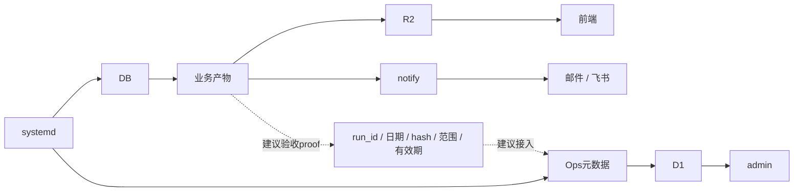

# 2026-11-10晚间体检综合报告

上轮修复有实际效果；这轮发现多个独立缺口，不能归为单一网络层或笼统架构错误。优先修输入有效性/通知完整性/结果可见性，再按证据优化采集与发布。 本次体检基于六路只读现场采样及独立交叉复核；22项均为建议，未实施、未认领。文档已完成，发布与回执见独立交接包；生产修复尚未实施，不是生产全面健康证明。

## 覆盖与固定事实

基线 `f35437a699d199076b5654dcde58780be89ee6b4`；消息窗口11/10 08:49:35–19:40 CST，运行/数据/监控采样约19:39–19:48，UI截至19:51:39，资格增补19:58，综合截至19:58:23。

- 23台账与23群消息仅时间、群、规范化标题对应；不保证正文一致。4邮件仅SMTP接受，QQ实收未知。

- 19:45:06快照：129正常、2警告、1严重、45未知，共177；34data=21stat+13无固定源，不是34事故；45未知=39固定能力边界+6动态状态。

- 原12格和Nov9三指数保留；17:00至17:05:06 rc124为新事件，16:20主档成功，非全日停产，代码回归未证。

- Ops19:15客户端超时但D1已落库，19:45警告消退，根治未证。

- 两ETF同Eastmoney两接口已公布；19:58名称谓词及完整候选通过，排2/5，未补库。016989第630，不在无游标首500，后续轮转有条件。

- 长锁593.324/1552.204秒均释放，非死锁；本地hash外移不能承诺消除25分钟网络耗时。

- A03/A04已有独立纯函数重放；仅动态desc用html.escape(desc, quote=False)，正常4例不变；未上线。

- UI两项P2有真实浏览器及390×844验证；实机iOS/Android未测。

- 15旧packet未ACK不等于无人工作；两dirty保留；#378已有实现未合，不能重复开发。

- 21:00备份、21:10换手、21:40overfit、22:30nextday未验；D1全UTC日至11/11 08:00 CST；未创建定时器。

- 完整207件证据20,747,656字节据父交接已SHA核验并私有本机留存；本次文档任务未重新验证该归档。

## 旧修有效与新增缺陷

- 原12格净值与Nov9三指数仍在且目标公开桶更新
- 三站核心资产与版本一致，近3天历史失败已被同工作流后续成功覆盖
- 45组服务/定时器及90单元与注册日历无漂移
- 16点D1两同步真实成功，不等于全UTC日配额优化通过

- 0/无效价参与突破判断并污染日内去重，已隔离重放
- 动态desc裸<导致9项正文只显示1，按quote=False构造边界转义已离线验证
- admin关注列表按输入顺序截8，2warning被unknown挤出，真实DOM和独立重算相符
- 移动端异常入口与可隐藏时间文字同容器，顶部不可见，页面下方仍有异常卡
- 17:00公募指数登录重连耗尽300秒，下午16:20主档成功，不是全日停产
- Ops19:15客户端未确认但服务端有快照，19:45警告自然恢复
- 上传持锁593.324/1552.204秒均已正常释放，不能称死锁

新发现不自动等于修后回归。按故障发生时间判断，不能用通知、采集或页面更新时间替代。

## 当前链路与建议

复用现有链路，数据/备份/发布owner定义成功合同；monitor不持业务写权限，不新增复杂监控栈。虚线尚未实施。

## 22项概览

完整改动范围、验收、依赖、回退及并行边界见 [tasks.md](tasks.md)，[tasks.json](tasks.json) 仅为本报告固定输入；任务状态权威仍为 pending-index。

|临时号|建议优先级|路径|任务|
|---|---|---|---|
|HC-01|P2|先修|无效行情不能触发破位或占用去重键|
|HC-02|P2|先修|恢复告警正文的全部条目|
|HC-03|P2|先修|监控默认列表优先显示严重和警告|
|HC-04|P2|先修|手机首屏保留紧凑异常入口|
|HC-05|P2|数据验收|两ETF与016989按精确键补缺并验公开结果|
|HC-06|P2|方案验证|公募重试服从整轮绝对截止时间|
|HC-07|P2|方案验证|减少每日重复扫400日并补长期NULL|
|HC-08|P2|先补证据|监控投递保留逐轮回执和三类时间|
|HC-09|P2|先补证据|D1按真实平台读写量验收益|
|HC-10|P2|方案验证|让数据、备份、发布有结果证明|
|HC-11|P2|先修|区分运行中、未接入和缺证据|
|HC-12|P2|先量测|定位长锁耗时再做安全缩锁|
|HC-13|P2|方案验证|关键对象覆盖前必须有可恢复旧版本|
|HC-14|P2|自然验收|新备份proof与恢复演练验收|
|HC-15|P2|自然验收|换手、overfit与下一日计划完整链验收|
|HC-16|P2|历史取证|历史冻结与备份原件按键追溯|
|HC-17|P2|供应商观察|保留CF504真实证据并核最终部署|
|HC-18|P2|先取证|核离岸人民币信号的单位尺度|
|HC-19|P3|可逆清理|隔离额外旧worktree三条测试镜像|
|HC-20|P3|容量维护|本机磁盘和已合并工作树整理|
|HC-21|P2|协作接力|单入口回执并处置既有待合分支|
|HC-22|P3|低优先优化|手机lab首屏说明去重但保留核心入口|

第一批：HC-01/02同owner串行；admin HC-03/08/11与monitor HC-08/10/11统一协调；手机HC-04可独立。公募HC-06/07共享文件串行，HC-05与07的FOF写集也需协调；上传HC-12/13同owner串行。HC-21先核既有实现与dirty归属。所有owner均待明确认领。

## 收益目标与自然验收（均不是本轮实测节省）

|范围|目标与验收|时点/状态|
|---|---|---|
|HC-01/02|零价不占去重；九条正文完整、正常4例不变|离线重放已有，生产未实施|
|HC-03/04/11|严重/警告可见；6动态未知可解释且不伪装成功|待实施与浏览器复验；实机待验|
|HC-05|两ETF两格与016989三格真源相等；旧非空不改；下游公开对应|自然补采后逐键验，未写库|
|HC-06/07|共享deadline有界、增量与同源全窗口一致|隔离方案与自然轮待验|
|HC-08/10|逐轮回执可关联；34项原因可解释；优先三链proof|待实施；unknown减少本身不算收益|
|HC-09|两表2/2有真实平台rows计数，并对账完整UTC日|11/11 08:00 CST后，未验|
|HC-12/13|同505文件工作集量测；备份失败不覆盖关键旧对象|未量测优化收益、故障注入未执行|
|HC-14|同run proof、对象hash/长度、恢复计数闭环；3库与public_fund策略SKIP分开|11/10 21:00计划，未验|
|HC-15换手|本轮完整补采及发布|21:10计划，未验|
|HC-15 overfit|主/ext同轮生成，各自公开文件与对应源文件SHA-256及长度一致；内容与投递完整，真实失败继续报警，保留74/red|21:40计划，未验|
|HC-15 nextday|真实非空目标计划、业务日期和公开投递一致|22:30计划，未验|
|HC-16至22|按每项原件、恢复、认领及实机标准验收|均未执行；不承诺节费或节时|

计划时点非完成期限，不等待未来轮、不创建定时器。

## 旧21类映射附录

由alerts单通道映射结合data/runtime/monitoring/delivery最新证据更新，不沿用单代理“未查”否定其他代理已证事实。

|旧类|本轮综合状态|
|---|---|
|preupload-date|摘要引用旧错误，非今日新备份失败；未重跑计数测试。|
|preupload-sentinel|摘要failed=0/exceptions=0；计数回归未重跑。|
|preupload-protection|成功自然上传已见；备份失败继续覆盖风险仍在（HC-13）。|
|history-overwrite|hits=61不等于61邮件或独立键；历史权威before待证。|
|r2-purge|长锁均释放非死锁；verify最终完成未证（HC-12）。|
|r2-intraday|公开手机可见性缺口已证；历史上传故障不冒称已根治。|
|nav016989|原12格及公开目标保留；Nov9三格待补（HC-05）。|
|fund-index-Nov9|Nov9三指数保留；17:00新超时非全日停产（HC-06）。|
|overfit-delivery|旧主/ext兼容证据保留；今晚21:40待验。|
|monitor-delivery|19:15已落D1，19:45警告消退；诊断链待补。|
|D1-quota|16点两表真实成功；平台生产读写量/全UTC日未验。|
|freeze136-and-trade9|136集合无新增；9交易缺口仍7历史冻结+2待NAV。|
|backup-verification|旧3库PASS不替新proof；21:00自然轮待验。|
|nextday|公开日期属上一自然轮；今晚22:30待验。|
|stall-wording|历史7日升级不等于连续停摆7日；本次17:05失败。|
|unit-registry-drift|45service/45timer共90单元与注册日历无漂移。|
|turnover|21:10自然轮未验，不挪用旧成功。|
|Actions-release-gate|近3天10失败均后续同流成功；CF内部原因未证。|
|risk74red|当前74/red保留，禁止降低阈值消警。|
|historical-373-Nov3|Nov1/2原备份与历史归因仍待原件。|
|test-mirror-isolation|6个存续目标SHA不变；3条09:18残留早于13:04清理。|

## 边界

仅脱敏汇总、任务、脚本及输入文件SHA公开。原始群/邮件、SQL行、Ops快照、截图、IP、凭据及账户ID不入仓，完整证据私有本机留存。体检实际执行只读SSH/HTTP/限量SQL/浏览器；报告生成器离线无网络；生产源码/库/配置未改，未部署、未发送消息、未修改TASKS/NOTES/pending-index。文档已完成，发布与回执见独立交接包。历史T0/备份原件、CF内部原因、CNH尺度、QQ实收和全部性能收益仍有限制，详见22任务。
