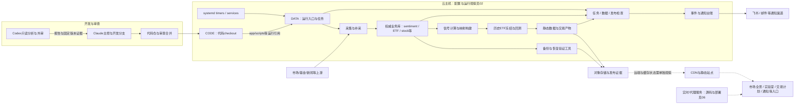
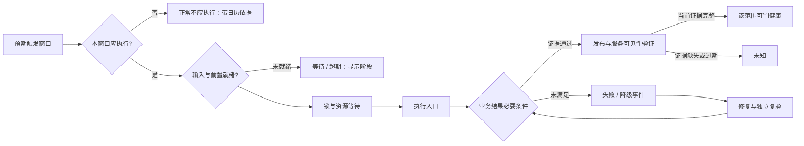
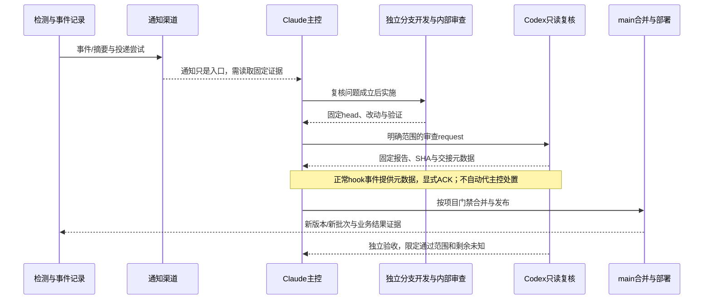

# 系统运行架构总览

本图谱的代码基线为`d4238f5b24aa1aa5632dd5fed1098ce9fbdb3620`。实际云端与本机观察有各自时间，见02和07；不是实时服务状态页面。实线表示已查源码中的逻辑连接，不代表每个部署节点已在线验证；虚线表示外部控制面未验证或后续设计连接。

## 一、执行与数据拓扑

图用于定位逻辑链路；准确服务名、入口、调度、状态及证据见各清单。外部存储/CDN/渠道存在配置或代码依据，不等于本次登录其控制面确认。实时服务的进程观察与前端实际请求来源应对照06，不能仅凭服务名推断全站请求都经同一后端。

## 二、三种事实不能合并

| 层 | 回答的问题 | 证据入口 |
| --- | --- | --- |
| 声明/源码 | 应该运行什么、读写什么、谁依赖谁 | 01任务源清单、03数据合同、04规则、06部署 |
| 部署/注册 | 实际安装了什么、何时触发、入口在哪里 | 02云端systemd/cron观察、07本机launchd观察（launchd 已废弃/历史存档，生产定时任务已迁云上 systemd timer） |
| 运行/业务结果 | 最近是否执行、数据是否完整可读、产物是否发布可见 | 运行观察、具体业务校验、发布proof与页面验证；本次未全量验收 |

`inactive`的oneshot通常只表示当前未执行；`active`只说明调度/进程层状态。程序exit0、文件mtime更新、对象上传成功、CDN purge、邮件发送和业务恢复是不同阶段。

## 三、任务与运行状态模型（面板拟议，不是统一实现现状）

调度计划、交易日/市场日历、最大时长、下游截止时间和采集证据有效期分别定义。实现前必须逐任务核对当前约定，不能把设计状态映射成现有代码已经具备的功能。

## 四、事件到修复的协作闭环

## 五、对账时必须保留的区别

- 代码仓、DATA权威库、静态副本和外部发布副本是不同资产；同名文件不证明同一内容。
- 交易主档有新mtime不证明某个原信号已入账；数据库有价格不证明实际消费者能读到它。
- 同日备份映射不自动等于冻结时实际使用的映射；缺可信历史输入时不能用今天映射补造历史。
- 规则定义、历史告警、当前检测、通知投递和人工回执是不同事实，不能互相替代。
- 业务过拟合/策略风险和系统故障分开看，不以“全部通知归零”为健康目标。

完整数据资产/写入责任、发布视图、监控分类、运行手册、对账和面板合同分别由03、06、04、05、10和08承担，避免总图变成另一份无法维护的配置副本。
