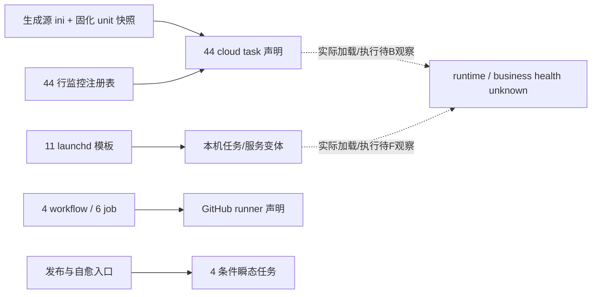

# 仓库声明的服务与计划任务（静态基线 v1）

代码基线 `d4238f5b24aa1aa5632dd5fed1098ce9fbdb3620`；盘点时间 2026-11-07T14:21:36.215918+08:00（Asia/Shanghai）。仅确认仓库声明，不代表已安装、启用、实际运行或业务健康。云端B、本机F的运行观察另列，不被本文覆盖。

共 **72 条任务/服务变体**：cloud systemd 44（配套timer同条记录）、launchd 11、CI job 6、条件瞬态4、手动入口2、仅旧文档本机声明5。所有health=unknown。

## 来源、匹配及边界

- `gen_systemd_units.py`明确读取 `docs/deploy/systemd-units-20260912.md`，所以它是当前生成配置源；标题日期不是生效时刻。本次不执行生成器。
- `docs/deploy/systemd-units-cloud-snapshot.txt`是仓库固化快照，44 service＋44 timer；不是本轮云端观察。配置源与快照两套字段均保留，差异见inventory.coverage.source_conflicts。
- `gen_schedule_stats.py`按字面AST展开17日志任务＋2特殊marker＋22 unit-only＋3自监控=44；只读字面值，不执行导入或函数。
- 全部11份受跟踪plist覆盖launchd/、scripts/、scripts/.disabled/、docs/auto-trade/、docs/fapi/launchd/。不读取实际LaunchAgents。4份workflow的6个job单列，不将每个step膨胀为计划任务。
- scripts/deploy.sh/update_all.sh/fund_nav_selfheal.sh的4种瞬态启动，以及deploy/main-merge手动入口另列；没有把仓库任意脚本都当调度任务。
- 仅旧文档出现的本机服务明确documented_only；停用目录不证明机器已停用，旧“未加载”描述不证明现在仍未加载。未发现受跟踪crontab文件，不代表主机无cron。
- 入口相对路径、声明日志与安全flag可展示；不复制完整ExecStart/连接参数、Environment值、账号、webhook。路径$DATA/$CODE/$LOCAL_DATA/$LOCAL_CODE为逻辑脱敏别名。

## 调度生态概览

## Cloud systemd 声明全目录

日历按配置字段逐项保留，预期Asia/Shanghai来自生成源统一约定；unit没有证明当前主机时区。多条OnCalendar是多个触发点，服务已运行时是否跳过/排队需运行证据。

| id / 名称 | 入口（只列文件/模块） | OnCalendar原字段 | 外层TimeoutStartSec | 日志/monitor | 源码锚点 |
| --- | --- | --- | --- | --- | --- |
| `task:ab-direction-anchor` AB方向锚 | `scripts/run_ab_direction_anchor.sh` | `*-*-* 21:15:00` | 600 | append:$DATA/data/logs/ab_direction_anchor.out.log append:$DATA/data/logs/ab_direction_anchor.err.log | docs/deploy/systemd-units-cloud-snapshot.txt:1 |
| `task:alert-weekly-review` 告警周报 | `scripts/alert_weekly_review.py` | `Mon *-*-* 08:20:00` | 600 | append:$DATA/data/logs/alert-weekly-review-launchd.log append:$DATA/data/logs/alert-weekly-review-launchd.err | docs/deploy/systemd-units-cloud-snapshot.txt:18 |
| `task:backfill-evening` 指数补采兜底 | `scripts/backfill_metrics.sh` | `*-*-* 16:35:00` `*-*-* 21:00:00` `*-*-* 02:00:00` | 0 | append:$DATA/data/logs/backfill_evening_launchd.log append:$DATA/data/logs/backfill_evening_launchd.err data/logs/backfill_evening_launchd.log | docs/deploy/systemd-units-cloud-snapshot.txt:35 |
| `task:backup-db` 数据库备份 | `scripts/backup_db.sh` | `*-*-* 21:00:00` | 12600 | journal；业务日志unknown | docs/deploy/systemd-units-cloud-snapshot.txt:52 |
| `task:brief-push` AI速递推送 | `scripts/brief_push_wrapper.sh` | `*-*-* 20:45:00` | 600 | append:$DATA/data/logs/brief_push_launchd.log append:$DATA/data/logs/brief_push_launchd.err | docs/deploy/systemd-units-cloud-snapshot.txt:68 |
| `task:check-data-gap` 数据缺口检测 | `scripts/check_data_gap_alerts.sh` | `Mon..Fri *-*-* 22:35:00` | 600 | append:$DATA/data/logs/check_data_gap_launchd.out append:$DATA/data/logs/check_data_gap_launchd.err data/logs/check_data_gap_launchd.log | docs/deploy/systemd-units-cloud-snapshot.txt:85 |
| `task:check-monitor-heartbeat` 监控心跳看门狗 | `scripts/check_monitor_heartbeat.py` | `*-*-* *:11,26,41,56:00` | 600 | append:$DATA/data/logs/check_monitor_heartbeat_launchd.log append:$DATA/data/logs/check_monitor_heartbeat_launchd.err | docs/deploy/systemd-units-cloud-snapshot.txt:102 |
| `task:cloud-unit-patrol` 云上unit漂移巡检 | `scripts/cloud_unit_patrol.sh` | `*-*-* 08:27:00` | 600 | data/logs/cloud_unit_patrol_launchd.log | docs/deploy/systemd-units-cloud-snapshot.txt:120 |
| `task:daily-brief` AI每日速递 | `scripts/run_daily_brief.sh` | `*-*-* 20:40:00` | 1740 | append:$DATA/data/logs/daily_brief_launchd.log append:$DATA/data/logs/daily_brief_launchd.err data/logs/daily_brief.log | docs/deploy/systemd-units-cloud-snapshot.txt:137 |
| `task:daily-summary-supplement` 摘要补采 | `scripts/daily_summary_email.py` | `*-*-* 20:25:00` | 600 | append:$DATA/data/logs/daily_summary_supplement_launchd.log append:$DATA/data/logs/daily_summary_supplement_launchd.err | docs/deploy/systemd-units-cloud-snapshot.txt:154 |
| `task:etf-national-team` ETF汪汪队 | `scripts/etf_national_team_backfill.sh` | `*-*-* 20:07:00` `*-*-* 21:30:00` | 0 | append:$DATA/data/logs/etf_national_team_launchd.log append:$DATA/data/logs/etf_national_team_launchd.err data/logs/etf_national_team_launchd.log | docs/deploy/systemd-units-cloud-snapshot.txt:170 |
| `task:etf-track-index` ETF跟踪指数 | `scripts/fetch_etf_track_index.py` | `Sun *-*-* 03:30:00` | 600 | append:$DATA/data/logs/etf-track-index-launchd.log append:$DATA/data/logs/etf-track-index-launchd.err | docs/deploy/systemd-units-cloud-snapshot.txt:187 |
| `task:fapi-daily` fapi日采集 | `scripts/fapi_daily_syn.sh` | `*-*-* 18:10:00` | 1800 | append:$DATA/data/logs/fapi_daily_launchd.log append:$DATA/data/logs/fapi_daily_launchd.err | docs/deploy/systemd-units-cloud-snapshot.txt:204 |
| `task:fetch-news` 新闻采集 | `scripts/fetch_news.py` | `*-*-* *:01,45:00` | 1080 | append:$DATA/data/logs/fetch_news_launchd.log append:$DATA/data/logs/fetch_news_launchd.err data/logs/fetch_news_launchd.log | docs/deploy/systemd-units-cloud-snapshot.txt:224 |
| `task:fof-nav-collect` FOF净值止漏 | `scripts/run_fof_nav_collect.sh` | `*-*-* 21:10:00` | 900 | journal；业务日志unknown | docs/deploy/systemd-units-cloud-snapshot.txt:240 |
| `task:freeze-orphan-cleanup` 冻结表清理 | `scripts/signal_kelly_freeze_cleanup.py` | `*-*-* 21:50:00` | 600 | append:$DATA/data/logs/freeze_cleanup_launchd.log append:$DATA/data/logs/freeze_cleanup_launchd.err | docs/deploy/systemd-units-cloud-snapshot.txt:252 |
| `task:futures-backfill` 期货机构持仓 | `scripts/futures_backfill.sh` | `*-*-* 19:45:00` `*-*-* 21:20:00` | 0 | append:$DATA/data/logs/futures_backfill_launchd.log append:$DATA/data/logs/futures_backfill_launchd.err data/logs/futures_backfill_launchd.log | docs/deploy/systemd-units-cloud-snapshot.txt:268 |
| `task:gold-night` 黄金夜盘 | `scripts/gold_night.sh` | `*-*-* 02:40:00` | 2700 | append:$DATA/data/logs/gold_night_launchd.log append:$DATA/data/logs/gold_night_launchd.err | docs/deploy/systemd-units-cloud-snapshot.txt:285 |
| `task:intraday-snapshot` 盘中快照 | `scripts/intraday_snapshot.sh` | `*-*-* 09:25:00` `*-*-* 09:35:00` `*-*-* 09:45:00` `*-*-* 09:55:00` `*-*-* 10:05:00` `*-*-* 10:15:00` `*-*-* 10:25:00` `*-*-* 10:35:00` `*-*-* 10:45:00` `*-*-* 10:55:00` `*-*-* 11:05:00` `*-*-* 11:15:00` `*-*-* 11:25:00` `*-*-* 11:32:00` `*-*-* 13:01:00` `*-*-* 13:05:00` `*-*-* 13:15:00` `*-*-* 13:25:00` `*-*-* 13:35:00` `*-*-* 13:45:00` `*-*-* 13:55:00` `*-*-* 14:05:00` `*-*-* 14:15:00` `*-*-* 14:25:00` `*-*-* 14:35:00` `*-*-* 14:45:00` `*-*-* 14:55:00` `*-*-* 15:02:00` `*-*-* 15:35:00` `*-*-* 20:35:00` | 0 | append:$DATA/data/logs/intraday_snapshot_launchd.log append:$DATA/data/logs/intraday_snapshot_launchd.err data/logs/intraday_snapshot_launchd.log | docs/deploy/systemd-units-cloud-snapshot.txt:302 |
| `task:kelly-intraday-rerun` 凯利盘中重算 | `scripts/kelly_intraday_rerun.sh` | `*-*-* 09:40:00` | 600 | append:$DATA/data/logs/kelly_intraday_rerun_launchd.log append:$DATA/data/logs/kelly_intraday_rerun_launchd.err | docs/deploy/systemd-units-cloud-snapshot.txt:319 |
| `task:lab-auto` 策略实验室 | `scripts/update_lab.sh` | `*-*-* 19:00:00` | 0 | append:$DATA/data/logs/update_lab_launchd.log append:$DATA/data/logs/update_lab_launchd.err data/logs/update_lab_launchd.log | docs/deploy/systemd-units-cloud-snapshot.txt:337 |
| `task:lhb-backfill` 龙虎榜 | `scripts/lhb_backfill.sh` | `*-*-* 18:50:00` `*-*-* 19:30:00` | 0 | append:$DATA/data/logs/lhb_backfill_launchd.log append:$DATA/data/logs/lhb_backfill_launchd.err data/logs/lhb_backfill_launchd.log | docs/deploy/systemd-units-cloud-snapshot.txt:354 |
| `task:lof-track-index` LOF跟踪指数 | `scripts/fetch_lof_track_index.py` | `Sun *-*-* 04:00:00` | 360 | append:$DATA/data/logs/lof-track-index-launchd.log append:$DATA/data/logs/lof-track-index-launchd.err | docs/deploy/systemd-units-cloud-snapshot.txt:371 |
| `task:nextday-gap-check` 次日买入计划伪跳空剔除 | `scripts/nextday_gap_check.sh` | `Mon..Fri *-*-* 09:26:00` | 1800 | data/logs/nextday_gap_check_launchd.log | docs/deploy/systemd-units-cloud-snapshot.txt:388 |
| `task:nextday-plan` 次日买入计划 | `scripts/nextday_plan.sh` | `Mon..Fri *-*-* 22:30:00` | 600 | data/logs/nextday_plan_launchd.log | docs/deploy/systemd-units-cloud-snapshot.txt:403 |
| `task:overfit-monitor` 过拟合监控 | `scripts/overfit_monitor.sh` | `Mon..Fri *-*-* 21:40:00` | 1920 | data/logs/overfit_monitor_launchd.log | docs/deploy/systemd-units-cloud-snapshot.txt:418 |
| `task:pf-score-daily` 场外基金评分 | `scripts/pf_score_daily.sh` | `*-*-* 16:00:00` | 600 | append:$DATA/data/logs/pf-score-daily-launchd.log append:$DATA/data/logs/pf-score-daily-launchd.log | docs/deploy/systemd-units-cloud-snapshot.txt:433 |
| `task:pf-score-weekly` 场外基金周评分 | `scripts/pf_score_weekly.sh` | `Sun *-*-* 03:17:00` | 4140 | append:$DATA/data/logs/pf-score-weekly-launchd.log append:$DATA/data/logs/pf-score-weekly-launchd.log | docs/deploy/systemd-units-cloud-snapshot.txt:450 |
| `task:pf-stage0-manager` 基金经理底座 | `scripts/stage0_manager.sh` | `*-*-01 02:47:00` | 0 | append:$DATA/data/logs/stage0-manager-launchd.log append:$DATA/data/logs/stage0-manager-launchd.log | docs/deploy/systemd-units-cloud-snapshot.txt:467 |
| `task:pf-stage0-nav` 基金净值底座 | `scripts/stage0_nav.sh` | `Fri *-*-* 01:43:00` | 0 | append:$DATA/data/logs/stage0-nav-launchd.log append:$DATA/data/logs/stage0-nav-launchd.log | docs/deploy/systemd-units-cloud-snapshot.txt:484 |
| `task:pf-stage0-overview` 基金基础底座 | `scripts/stage0_overview.sh` | `Sun *-*-* 02:17:00` | 26820 | append:$DATA/data/logs/stage0-overview-launchd.log append:$DATA/data/logs/stage0-overview-launchd.log | docs/deploy/systemd-units-cloud-snapshot.txt:501 |
| `task:pf-stage0-risk` 基金风险底座 | `scripts/stage0_risk.sh` | `*-*-15 02:33:00` | 0 | append:$DATA/data/logs/stage0-risk-launchd.log append:$DATA/data/logs/stage0-risk-launchd.log | docs/deploy/systemd-units-cloud-snapshot.txt:518 |
| `task:public-fund-daily` 公募日更 | `scripts/public_fund_daily.sh` | `*-*-* 16:20:00` `*-*-* 17:00:00` | 2100 | append:$DATA/data/logs/public_fund_daily_launchd.log append:$DATA/data/logs/public_fund_daily_launchd.err | docs/deploy/systemd-units-cloud-snapshot.txt:535 |
| `task:public-fund-estimation` 盘中估值 | `scripts/public_fund_estimation.sh` | `*-*-* 10:00:00` `*-*-* 11:00:00` `*-*-* 13:30:00` `*-*-* 14:30:00` | 600 | append:$DATA/data/logs/public_fund_estimation_launchd.log append:$DATA/data/logs/public_fund_estimation_launchd.err | docs/deploy/systemd-units-cloud-snapshot.txt:552 |
| `task:public-fund-full` 公募全量 | `scripts/public_fund_full.sh` | `*-*-* 22:00:00` | 0 | append:$DATA/data/logs/public_fund_full_launchd.log append:$DATA/data/logs/public_fund_full_launchd.err | docs/deploy/systemd-units-cloud-snapshot.txt:569 |
| `task:public-fund-quarterly` 季报采集 | `scripts/public_fund_quarterly.sh` | `*-*-* 03:00:00` `*-*-* 04:00:00` `*-*-* 07:00:00` | 0 | append:$DATA/data/logs/public_fund_quarterly_launchd.log append:$DATA/data/logs/public_fund_quarterly_launchd.err | docs/deploy/systemd-units-cloud-snapshot.txt:586 |
| `task:r2-consistency` 三站一致性巡检 | `scripts/check_r2_consistency.sh` | `*-*-* 23:20:00` | 1800 | data/logs/r2_consistency_launchd.log | docs/deploy/systemd-units-cloud-snapshot.txt:603 |
| `task:rzhb-backfill` 两融 | `scripts/rzhb_backfill.sh` | `*-*-* 08:00:00` | 600 | append:$DATA/data/logs/rzhb_backfill_launchd.log append:$DATA/data/logs/rzhb_backfill_launchd.err data/logs/rzhb_backfill_launchd.log | docs/deploy/systemd-units-cloud-snapshot.txt:619 |
| `task:s06-snapshot` S06快照重生 | `scripts/s06_snapshot.sh` | `Mon..Fri *-*-* 20:35:00` | 7020 | data/logs/s06_snapshot_launchd.log | docs/deploy/systemd-units-cloud-snapshot.txt:636 |
| `task:schedule-monitor` 监控本体 | `scripts/schedule_monitor.sh` | `*-*-* *:00,15,30,45:00` | 600 | append:$DATA/data/logs/schedule_monitor_launchd.log append:$DATA/data/logs/schedule_monitor_launchd.err | docs/deploy/systemd-units-cloud-snapshot.txt:651 |
| `task:self-heal` 自愈本体 | `scripts/self_heal.sh` | `*-*-* *:07,22,37,52:00` | 600 | append:$DATA/data/logs/self_heal_launchd.log append:$DATA/data/logs/self_heal_launchd.err | docs/deploy/systemd-units-cloud-snapshot.txt:668 |
| `task:turnover-backfill` 换手率独立延后 | `scripts/turnover_backfill.sh` | `Mon..Fri *-*-* 21:10:00` | 0 | data/logs/turnover_backfill_launchd.log | docs/deploy/systemd-units-cloud-snapshot.txt:686 |
| `task:update-all` 收盘全量 | `scripts/update_all.sh` | `Mon..Sat 17:50:00` `Sun 22:30:00` | 0 | append:$DATA/data/logs/update_all_launchd.log append:$DATA/data/logs/update_all_launchd.err data/logs/update_all_launchd.log | docs/deploy/systemd-units-cloud-snapshot.txt:701 |
| `task:us-stock-morning` 美股早采 | `scripts/us_stock_morning.sh` | `*-*-* 05:00:00` | 0 | append:$DATA/data/logs/us_stock_morning_launchd.log append:$DATA/data/logs/us_stock_morning_launchd.err data/logs/us_stock_morning_launchd.log | docs/deploy/systemd-units-cloud-snapshot.txt:718 |

## Mac、CI、瞬态和手动/历史声明目录

Mac与cloud同名项是独立调度声明，不证明两地同时执行。未读取私人home或LaunchAgents，具体本机运行态由F提供。

| id | 类别 / 调度器 | 入口 | 声明频次 / 状态 | 证据 |
| --- | --- | --- | --- | --- |
| `task:nextday-plan:mac` | task / launchd | `scripts/nextday_plan.sh` | [{"Weekday": 1, "Hour": 22, "Minute": 30}, {"Weekday": 2, "Hour": 22, "Minute": 30}, {"Weekday": 3, "Hour": 22, "Minute": 30}, {"Weekday": 4, "Hour": 22, "Minute": 30}, {"Weekday": 5, "Hour": 22, "Minute": 30}]；present_in_repository_runtime_unknown | docs/auto-trade/com.trade.nextday-plan.plist:5 |
| `task:fapi-daily:mac` | task / launchd | `scripts/fapi_daily_syn.sh` | {"Hour": 18, "Minute": 10}；present_in_repository_runtime_unknown | docs/fapi/launchd/fapi-daily.plist:12 |
| `service:agent-inbox-watcher:mac` | service / launchd | `scripts/agent_inbox_watcher.py` | RunAtLoad/KeepAlive；present_in_repository_runtime_unknown | launchd/com.trade.agent-inbox-watcher.plist:19 |
| `task:check-data-gap:mac` | task / launchd | `scripts/check_data_gap_alerts.sh` | [{"Weekday": 1, "Hour": 22, "Minute": 35}, {"Weekday": 2, "Hour": 22, "Minute": 35}, {"Weekday": 3, "Hour": 22, "Minute": 35}, {"Weekday": 4, "Hour": 22, "Minute": 35}, {"Weekday": 5, "Hour": 22, "Minute": 35}]；present_in_repository_runtime_unknown | launchd/com.trade.check-data-gap.plist:5 |
| `task:s06-snapshot:mac` | task / launchd | `scripts/s06_snapshot.sh` | [{"Weekday": 1, "Hour": 20, "Minute": 35}, {"Weekday": 2, "Hour": 20, "Minute": 35}, {"Weekday": 3, "Hour": 20, "Minute": 35}, {"Weekday": 4, "Hour": 20, "Minute": 35}, {"Weekday": 5, "Hour": 20, "Minute": 35}]；present_in_repository_runtime_unknown | launchd/com.trade.s06-snapshot.plist:5 |
| `task:sentiment:mac` | task / launchd | `module:app.scheduler` | {"Hour": 15, "Minute": 33}；legacy_template; generator_doc_section6_says_historically_unloaded; current_unknown | launchd/com.trade.sentiment.plist:5 |
| `task:turnover-backfill:mac` | task / launchd | `scripts/turnover_backfill.sh` | [{"Weekday": 1, "Hour": 21, "Minute": 10}, {"Weekday": 2, "Hour": 21, "Minute": 10}, {"Weekday": 3, "Hour": 21, "Minute": 10}, {"Weekday": 4, "Hour": 21, "Minute": 10}, {"Weekday": 5, "Hour": 21, "Minute": 10}]；present_in_repository_runtime_unknown | launchd/com.trade.turnover-backfill.plist:5 |
| `service:thinking-proxy-kimi:mac` | service / launchd | `scripts/sensenova-rotate-proxy-kimi.sh` | RunAtLoad/KeepAlive；disabled_template_directory; runtime_unknown | scripts/.disabled/com.trade.thinking-proxy-kimi.plist:17 |
| `task:ab-direction-anchor:mac` | task / launchd | `scripts/run_ab_direction_anchor.sh` | {"Hour": 21, "Minute": 15}；present_in_repository_runtime_unknown | scripts/com.trade.ab-direction-anchor.plist:5 |
| `task:sensenova-healthcheck:mac` | task / launchd | `scripts/sensenova-proxy-healthcheck.py` | every 300 seconds；present_in_repository_runtime_unknown | scripts/com.trade.sensenova-healthcheck.plist:12 |
| `service:thinking-proxy:mac` | service / launchd | `scripts/sensenova-rotate-proxy.sh` | RunAtLoad/KeepAlive；present_in_repository_runtime_unknown | scripts/com.trade.thinking-proxy.plist:16 |
| `task:ci:ci:quality-gate-static` | task / GitHub Actions | `workflow:.github/workflows/ci.yml#quality-gate-static` | event-driven; no wall-clock cron；ci_only | .github/workflows/ci.yml:98 |
| `task:ci:ci:quality-gate-data` | task / GitHub Actions | `workflow:.github/workflows/ci.yml#quality-gate-data` | event-driven; no wall-clock cron；ci_only | .github/workflows/ci.yml:228 |
| `task:ci:deploy-cf:deploy` | task / GitHub Actions | `workflow:.github/workflows/deploy-cf.yml#deploy` | event-driven; no wall-clock cron；ci_only | .github/workflows/deploy-cf.yml:27 |
| `task:ci:deploy-pages:build` | task / GitHub Actions | `workflow:.github/workflows/deploy-pages.yml#build` | event-driven; no wall-clock cron；ci_only | .github/workflows/deploy-pages.yml:14 |
| `task:ci:deploy-pages:deploy` | task / GitHub Actions | `workflow:.github/workflows/deploy-pages.yml#deploy` | event-driven; no wall-clock cron；ci_only | .github/workflows/deploy-pages.yml:22 |
| `task:ci:pack-work-mode-standard:pack` | task / GitHub Actions | `workflow:.github/workflows/pack-work-mode-standard.yml#pack` | event-driven; no wall-clock cron；ci_only | .github/workflows/pack-work-mode-standard.yml:43 |
| `task:r2-upload-async` | task / systemd transient / local nohup fallback | `scripts/r2_upload_async.sh` | per eligible parent execution；conditional_on_demand_not_periodic | scripts/deploy.sh:794 |
| `task:staticdata-backup-async` | task / systemd transient / local nohup fallback | `scripts/staticdata_backup_async.sh` | per eligible parent execution；conditional_on_demand_not_periodic | scripts/deploy.sh:1125 |
| `task:fund-nav-upload-async` | task / systemd transient / local nohup fallback | `scripts/fund_nav_upload_async.sh` | per eligible parent execution；conditional_on_demand_not_periodic | scripts/update_all.sh:131 |
| `task:fund-nav-selfheal-upload` | task / systemd transient / local nohup fallback | `scripts/upload_r2.py` | per eligible parent execution；conditional_on_demand_not_periodic | scripts/fund_nav_selfheal.sh:205 |
| `task:deploy` | task / manual or parent-script invocation | `scripts/deploy.sh` | on demand；manual_or_called_entrypoint | scripts/deploy.sh:1 |
| `task:main-merge` | task / manual or parent-script invocation | `scripts/main-merge.sh` | on demand；manual_or_called_entrypoint | scripts/main-merge.sh:1 |
| `service:feishu-listener:mac` | service / unknown | unknown | unknown；historical_document_only_runtime_unknown | docs/deploy/systemd-units-20260912.md:1520 |
| `task:token-cache-stats:mac` | task / unknown | unknown | unknown；historical_document_only_runtime_unknown | docs/deploy/systemd-units-20260912.md:1563 |
| `task:claude-self-backup:mac` | task / unknown | unknown | unknown；historical_document_only_runtime_unknown | docs/deploy/systemd-units-20260912.md:1563 |
| `service:codex-watcher:mac` | service / unknown | unknown | unknown；historical_document_only_runtime_unknown | docs/deploy/systemd-units-20260912.md:1573 |
| `task:monitor-72h:mac` | task / unknown | `scripts/monitor_72h.sh` | unknown；historical_document_only_runtime_unknown | docs/deploy/systemd-units-20260912.md:1573 |

## 关键窗口与冲突候选（不是已证实故障）

- **16:20/17:00公募日更→17:50 update-all→18:10 FAPI**：配置源public-fund-daily外层2100s；主链有TimeoutStartSec=0项。窗口存在不证明依赖已满足，业务超时与锁持有范围需逐链验证。
- **20:35 intraday-snapshot与S06同槽；21:00 backfill-evening与backup-db同槽；21:10 turnover与FOF同槽；21:30 ETF/21:40 overfit/21:50 orphan/22:00全量公募/22:30计划/22:35缺口**：这是资源争用、数据就绪与晚到冻结的对账候选，不能仅凭重叠断定冲突。
- **每15分钟三自监控**：schedule-monitor :00/:15/:30/:45；self-heal :07/:22/:37/:52；heartbeat :11/:26/:41/:56。定时错开不证明业务恢复或健康，阈值口径交D。
- fetch-news的当前配置字段是 `*:01,45:00`，与同文档标题“:01/:31”及统计展示“每30min”不一致；保留字段，不按旧标题改写。schedule-monitor/statistics的时间展示不取代timer配置。
- 周日update-all 22:30区别于Mon..Sat17:50；所有Persistent=true不自动证明交易日门控。Mac host时区未知，StartCalendarInterval不能默认当已验证北京时间。
- `TimeoutStartSec=0`是外层启动计时不设限的配置，不证明内层没有超时/停止机制；每条细节保持source_candidates或unknown。
- 一份`scripts/com.trade.sensenova-healthcheck.plist`严格XML解析失败：仅在内存移除XML注释后抽取声明，inventory保留异常；这不是机器当前服务失败证据。
- 瞬态systemd-run与本机nohup的失败/取消语义不同，异步触发成功不等于上传或备份完成。日志路径与锁/重试只标源层候选，未对全部子脚本深追。

## 如何使用与后续核验

机器目录见[inventory/repository_tasks.json](inventory/repository_tasks.json)。每条含entrypoint、位置、调度/时区/日历、频次、输入输出unknown或候选、锁/超时/重试、失败/恢复unknown、监控、手册、anchor。`dependency_candidates`不能直接画成已确认依赖；仅CI配置显式needs生成已确认depends_on边，其它未证依赖仍是候选。

[systemd生成源](../../deploy/systemd-units-20260912.md)、[超时口径](../../deploy/timeout-caliber-20260916.md)仍是原专题权威。当前health全部unknown；B/F补运行观察，D负责监控判据，其它主题补数据/依赖关系。公开健康页、整改方案、启用/部署均非本次产出。

## 可复现性

私有证据目录 `/tmp/codex-reports/ops-architecture-baseline-20261107/services-*` 记录解析脚本、源SHA与schema/计数核验；不执行生成器、shell任务、CI、部署或dry-run。覆盖与排除以JSON.coverage为准，不宣称机器现存全部计划任务。
