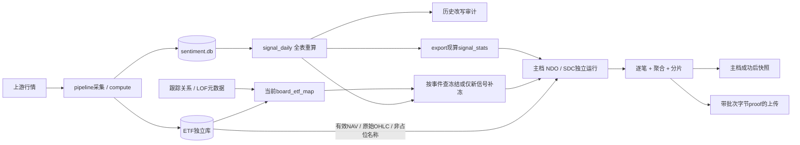
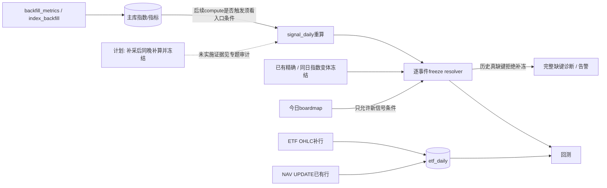
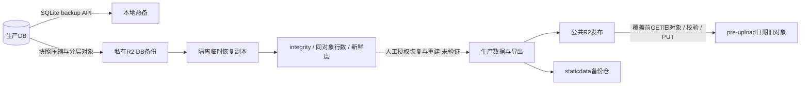

# 数据资产、生产依赖与写入责任（任务 C）

代码基线 `d4238f5b24aa1aa5632dd5fed1098ce9fbdb3620`；源码观察时间 `2026-11-07T14:20:32.660050+08:00`（Asia/Shanghai）。本页是现状知识库的索引，不替代现有专题runbook，不提供可执行生产修复命令。清单为 **34组关键资产、50条依赖边**，不是全表/全站/全任务穷举。

本轮只读源码，没有导入业务模块、连接DB、读取大JSON、读运行环境/凭证、访问云主机/R2/CF或执行任务。故所有资产的 `health=unknown`。`code_confirmed`表示代码合同已读，不表示部署已运行；配置、源码、运行观察三层不能互相替代。当前主机进程身份、实际解析路径、数据新鲜度与远端对象恢复能力仍待运行取证。

## 权威路径与镜像

`REPO`指逻辑运行数据树，`GIT_REPO`指代码树，`STATICDATA_REPO`指静态备份仓；具体主机路径与挂载由环境/仓布局决定，本页使用安全路径变量。`repo_paths.sh::resolve_repo`尊重显式环境，缺省按scripts符号链接或sibling布局推导。app.db保留logical absolute路径，显式DB变量无效时拒绝静默回退；不是所有模块都使用同一resolver。

- sentiment主库按显式库文件→REPO→MAIN_REPO→sibling trade-data→logical tree阶梯找非空库。get_conn还会迁移，盘点不可调用。
- ETF、stock、public_fund是独立SQLite文件，collector多用logical absolute路径；Kelly ETF loader另优先sibling trade-data主库。运行前需对照每入口解析路径，不能默认CODE副本是主库。
- `$REPO/data/signal_stats.json`是compute工作文件；`$REPO/static-site/data/signal_stats.json`是export重新计算的发布输入，Kelly优先后者。相同文件名不代表相同数据水位。
- board map有明确root-data→runtime static→CODE/data复制与哈希合同。其它CODE/data/静态副本没有全树“始终同源”的证明。copy/rsync产物不是DB权威源。
- staticdata备份脚本复制的是runtime `static-site/data/`，不自动覆盖root `data/signal_kelly_etf_freeze.json`。冻结表备份/日期快照不能从“静态JSON备份成功”推断。

## 三条关键链

图中实线为源码关系，虚线为尚未证明自动执行的人工恢复/计划或运行边。节点仅表示本页处理阶段，不复刻A的任务/服务清单或E的站点枚举。

### 1. 日常采集 → 信号冻结 → 回测

update_all启动core/width/futures/stock流水线，等待前三条后统一deploy，stock后台不等；pipeline里采集部分失败可继续compute。SQLite WAL允许并发读、写者串行，不等于各库/各JSON一份全局快照。signal_daily的DELETE+INSERT及审计不意味着历史原值受到阻断式保护。

export7.9.1现算stats；7.9.2主档子进程预算180s，主档成功才触发快照与SDC（300s）。异常/失败多为记录后继续export，所以全局exit0不证这几个产物都成功。背靠背NDO/SDC也没有跨进程同一DB事务快照的源码证明；要记录输入身份后才可宣称严格同快照。

### 2. 补采 → 历史事件与恢复边界

`backfill_metrics.sh`补指数/direct指标，并独立检查snapshot；其总rc只聚合主要采集，不把snapshot业务告警算同一退出码。index_backfill有自己的条件后续逻辑，不能简化成“所有backfill每次都补算并冻结”。信号晚出现不等于拥有当时ETF冻结；exact失败可按date/index已有信号变体兜底，但历史真缺键不得用今日best补造。

ETF NAV补齐仅更新已有行，缺整行需OHLC先建行；新 `_upsert_daily`已保护/解析名称，主动code占位仍须被价格loader过滤。类型归属、行存在、有效价与事件实际入账是四层不同验收。

### 3. 备份 → 恢复 → 发布

本地备份同盘不防盘毁；backup_db的本地RC不包含R2与verify失败，单项软失败会单独记录/告警。verify恢复到临时目录，PASS不等于生产已替换或发布正确。大库restore有Range流式/解压/完整性检查合同，但远端对象、生命周期、当前恢复演练未实测。

pre-upload源是将被覆盖的远端旧对象，非本地新文件。单PUT完整MD5+有效长度匹配可省同日重复传输；multipart ETag不能当整包MD5，既有P6长度检查不是完整内容证明。当前备份失败不阻断主上传，同日固定key会覆盖更早旧版，不能称完整版本仓。

## 关键资产对账表

| 公共ID | 路径/角色 | 写入责任与验收边界 |
|---|---|---|
| `data:sentiment-db` | $REPO/data/sentiment.db | app.collector.runner；SQLite WAL、busy_timeout；按表写入，不是所有表同种更新；显式DB覆盖例外 |
| `data:etf-db` | $REPO/data/etf_national_team.db | etf_national_team.pipeline_daily/backfill/intraday；独立SQLite WAL；_upsert_daily按(date,etf_code)UPSERT；NAV只UPDATE已有行，缺整行先需OHLC |
| `data:stock-db` | $REPO/data/stock_daily.db | app.collector.stock_daily；独立SQLite WAL，stock_daily_raw；采集进度另文件 |
| `data:public-fund-db` | $REPO/data/public_fund.db | app.collector.public_fund；独立SQLite WAL与public_fund.lock合同 |
| `data:index-daily` | sentiment.db::index_daily | collector.runner.upsert_index_rows；按键写入并接历史改写审计；不把所有表误称追加 |
| `data:score-daily` | sentiment.db::score_daily | compute.sentiment/cross等store；SQLite(date,score_id)键；is_freeze是分数状态，不等同ETF映射冻结文件 |
| `data:signal-daily` | sentiment.db::signal_daily | app.compute.signals.store；DELETE全表后INSERT OR REPLACE，commit；重算前后历史快照审计失败不阻断 |
| `data:history-overwrite-audit` | sentiment.db::history_overwrite_audit | app.history_audit；记录disappeared/appeared/changed；观察不阻断主写 |
| `data:board-etf-map` | $REPO/data/board_etf_map.json | scripts/build_board_etf_map.py::main；atomic_write_text；deploy前.deploybak，失败恢复旧版；成功复制静态版和CODE/data并校验 |
| `data:map-inputs` | $REPO/data/etf_index_map.json；$REPO/data/etf_track_index.json；$REPO/data/lof_track_index.json | gen_etf_index_map/相关元数据更新；各生成器合同不同，本次未穷举所有上游写者 |
| `data:etf-freeze` | $ROOT/data/signal_kelly_etf_freeze.json；SIGNAL_KELLY_ETF_FREEZE_PATH explicit override | signal_kelly_backtest::_resolve_etf/_save_etf_freeze；全文件atomic_write_json；精确键优先，同date/index变体按rank兜底；sidecar flock 串行锁(2026-11-09 FREEZE-PERSIST-P1-01, _save_etf_freeze:314) |
| `data:freeze-registries` | config/signal_kelly_frozen_missing_accepted.json；config/signal_kelly_freeze_orphan_backfill.json | 人工审核的配置变更；配置登记，不是冻结数据恢复；全局union默认不由有登记自动翻转 |
| `data:frozen-missing-audit` | $ROOT/data/audit/frozen_missing/<run_id>.json | Kelly _archive_frozen_missing_diagnostics；暂存私有目录、atomic JSON mode0600；完整事件记录合同 |
| `data:signal-stats-work` | $ROOT/data/signal_stats.json | app.compute.signal_stats.store；固定.tmp + replace；避免文件半写的意图，不声称并发丢更新已消除 |
| `data:signal-stats` | $REPO/static-site/data/signal_stats.json | static-site/export.py 7.9.1 _get_stats/write_json；现算stats并独立atomic写，非复制root/data旧文件 |
| `data:kelly-trades` | $REPO/static-site/data/signal_kelly_trades.json | signal_kelly_backtest主档，由export7.9.2触发；atomic JSON/分片独立写；输出完整性不代表所有eligible事件包含 |
| `data:kelly-trades-sdc` | $REPO/static-site/data/signal_kelly_trades_sdc.json | export7.9.2b→Kelly KELLY_BUY_NEXTDAY=0；显式两个输出参数；主档成功后才触发，独立文件非跨档事务 |
| `data:kelly-summary` | $REPO/static-site/data/signal_kelly_backtest*.json；$REPO/static-site/data/signal_kelly_parts/ and sdc counterparts | signal_kelly_backtest output writers；聚合/明细/分片分别atomic写，不保证整体事务 |
| `data:kelly-snapshots` | $REPO/static-site/data/signal_kelly_snapshots/ | signal_kelly_snapshot.py，由export主回测成功后触发；单日快照/index写者合同；全目录恢复一致性需核 |
| `data:schedule-stats` | $REPO/static-site/data/schedule_stats.json | gen_schedule_stats.py；atomic_write_json输出；push_schedule_stats独立推送 |
| `data:runtime-logs` | $REPO/data/logs/ | pipeline/update_all/backfill/deploy/backup各入口；追加日志、不同入口单独文件，读者有尾窗/.gz支持 |
| `data:notify-ledger` | $REPO/data/alerts/alert_ledger.jsonl | notify._record_ledger；JSONL append + flock，记录实际投递结果；非当前故障状态库 |
| `data:alert-state` | $REPO/data/alerts/latest.md；$REPO/data/alert_state.json；$REPO/data/alerts/data_gap_alert_state.json | notify.write_alert；latest覆盖；去重/ack/当前事实文件各有owner，不合并为同一语义 |
| `data:alert-buffers` | $REPO/data/alerts/alert_digest*.json*；$REPO/data/alerts/warning_buffer.jsonl；$REPO/data/notify_dedup.json | notify defer/flush机制；独立flush/dedup锁+buffer flock；pending分段确认再清理 |
| `data:local-db-backups` | $REPO/data/backups/<name>_<stamp>.db | backup_db.sh::backup_one；sqlite3.Connection.backup一致快照；本地保留期按mtime删除 |
| `data:r2-db-backups` | private backup bucket: backup/ weekly/ monthly/ | upload_r2.cmd_upload_db及大库快照流式函数；DB快照→gzip→单PUT/multipart，周/月另拷贝/上传；按桶路由 |
| `data:preupload-backups` | private bucket: pre-upload/<YYYYMMDD>/<original-key> | upload_r2._backup_overwritten_keys；跨账号GET旧源→校验→PUT备份→HEAD；单PUTMD5+长度可同日复用，multipart不当整包MD5 |
| `data:staticdata-backups` | $STATICDATA_REPO/data/；$STATICDATA_REPO/db/ (conditional) | staticdata_backup_async.sh；rsync runtime static-site/data；git段锁内；大JSON排除分流，DB本地复制开关默认关闭 |
| `data:upload-state` | $REPO/data/.r2_<channel>_state.json；$REPO/data/.r2_<channel>_ckpt.json；$REPO/data/.r2_<channel>_uploading.marker | upload_r2._incremental_upload；state全成功才原子写；marker先写后成功清理；checkpoint记录已确认主上传指纹 |
| `data:export-proof` | private per-run temp proof.json + run capability；pending publication context paths: runtime-specific unknown | export write_run_proof/deploy unique invocation；精确size/SHA256关联run/static_dir；私有写入/原子发布；非仅文件mtime |
| `data:published-data` | public data bucket: data/ and channel prefixes | upload_r2 channels/deploy async handoff；每keyPUT/校验与发布上下文；公共写门禁；purge与上传分开 |
| `data:restore-drill` | temporary restore directory/*.db/*.gz/result.json；$REPO/data/logs/verify_backup* | restore_r2_db_backup.py/verify_backup.sh；下载到隔离目录→解压→integrity/行数/新鲜度比较；不是原地替换生产 |
| `data:code-mirror` | $GIT_REPO/data/board_etf_map.json；$GIT_REPO/static-site/data/ | deploy cp/rsync；明确复制对象；不同inode/mtime相同不等于同文件，非全部data自动同步 |
| `data:export-manifest` | $REPO/static-site/data/export_manifest.json | static-site/export.py incremental engine；源日期/代码配置指纹与产物白名单；具体manifest写路径由export负责 |

## 观察与通知也属于数据资产

schedule_stats由日志/marker派生，不是业务健康真值；执行开始/结束时刻、交易日、R2排队、成功/锁跳过需分字段对账。alert_ledger是投递结果台账，latest/ack/dedup/buffer是不同writer的状态；“发了通知”“已确认”“没有再通知”都不等于故障恢复。私有台账不得直接原样公开到面板。

## 校验、缺口与后续核实

1. 当前runtime路径/inode、REPO注入、真实writer及锁持有者：unknown，交运行资产/任务盘点补证；本页不把历史incident当当前写入故障。
2. DB最新业务日、目标表键覆盖、frame/NULL/名称质量及冻结相容性：unknown；不读取DB内容来假造健康。
3. CF桶与跨账号路由、生命周期规则、对象版本/实际备份恢复、缓存失效：unknown，需控制面与对象级只读证据；代码注释中的7/14/28/365天仅为声明。
4. root-data freeze、frozen_missing诊断、alerts/ledger等不在普通DB热备或staticdata rsync源内，备份覆盖不能默认继承。需要逐项归属，不建议用旧整表或今天map重建历史冻结。
5. 全表信号重算、原子单文件替换、SQLite WAL及git阶段锁各管不同边界；没有证明一个事务覆盖多库、freeze、stats、main/SDC与远端发布。多writer语义串行化/快照一致性仍需取证。
6. 日期boardmap快照、补采后同晚计算/冻结与谨慎guard放宽在专题审计为计划，不能画成已运行。保持guard和当前配置，本文不提执行修复。

## 证据和维护

每个asset/edge都有源码文件、符号/行号与固定ref；JSON中保留producer/consumer、更新/时间/备份合同和unknown范围。edge的source_id/target_id仅指本页资产或合同列出的公共repo/external ID；任务节点未确认的关系不编造A的ID。`depends_on`与 `dependency_candidates`分开，推断人工恢复边显式inferred。

专题权威链接：

- [路径解析规范](../195-resolve-repo-plan-20261006.md)
- [覆盖前备份实现](../237-preupload-relay-impl-20261010.md)
- [只复用同内容备份](../preupload-reuse-20261106.md)
- [NULL名称写入合同](../signal-gap-name-contract-20261107.md)
- [七键历史处置与未实施防复发](../signal-gap-7keys-disposition-20261107.md)
- [本次清单合同](./_inventory-contract.md)

此v1只覆盖关键资产及一跳调用，不穷举所有采集表、所有写库点、所有站点或生产计划任务；这些边界在JSON coverage中同样声明。
