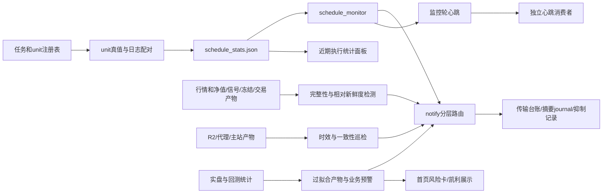

# 监控与告警现状基线

基线代码 `d4238f5b24aa1aa5632dd5fed1098ce9fbdb3620`，盘点日期 2026-11-07，Asia/Shanghai。本文只确认仓库声明与代码路径，**没有观察线上运行态**；所有实际部署、当前故障与健康均为 unknown。任务/服务 active、退出 0、通知成功分别属于不同证据层，均不能直接证明业务恢复。既有专题文档保持权威，本页作索引与对账基线。

## 证据与覆盖分母

机器清单见 [monitors.json](inventory/monitors.json)，遵循 [数据合同](_inventory-contract.md)。`schedule_monitor.sh::TASKS` 与 `gen_schedule_stats.py::TASKS` 均为 17 项，不代表只有 17 项被注册：另有 `EXTRA_MARKER_SCANS` 2 项、`UNIT_ONLY` 22 项、`SELF_MONITOR_UNITS` 3 项；`_mk_registry` 静态展开共 44 项，41 项声明进执行统计，3 项自监控声明不入表。**44 是代码注册分母，不是 44 个现场已加载或健康 unit。** 实际部署与运行观察交 parent 的服务/任务清单联查。

`check_data_gap_alerts.py::run` 分派 12 个检查家族；`overfit_monitor.py::ALERT_RULES` 声明 5 类，`evaluate_alerts` 实际有 4 类触发路径，象限退化明确预留。本轮不把规则定义计作故障，不将旧文档中的线上记录当今天的观察。

## 检测与产物链

图中箭头仅表示代码消费关系，非实时连通性图；所有节点现场健康 unknown。文件层出处由 inventory 的 source 符号/行锚给出。

| 类别 | 入口/依据 | 声明频率和阈值来源 | 去重、失败、恢复与盲点 |
| --- | --- | --- | --- |
| 任务状态 | `schedule_monitor.sh`、`gen_schedule_stats.py`、`unit_truth.py` | monitor 注释 15min；漏跑容忍30min，按交易日/时点/任务耗时阈值；实际挂载 unknown | systemd属性、同实例日志与持久ledger分层；not-found/never-ran/no-record不可视为0；刷新失败可能沿用旧stats |
| 数据完整性 | `check_data_gap_alerts.py::run`、`check_data_integrity.py` | gap声明交易日22:35；12个检查家族；门限按交易日/自然日/行数分别定义 | gap同key当日去重、ACK24h；info仍算active；`run`返回0不代表无findings；deploy-mode仅占位残留子集 |
| 信号/冻结/交易 | gap的kelly覆盖、新鲜度、回测失败检查；`check_s06_freshness.py` | kelly回溯5日、滞后1/2交易日分级；产物mtime48h等；S06相对入库指数>1交易日 | 冻结、价格、名字、信号和交易逐层定位；S06生成时间新不抵消覆盖旧；两端共同陈旧仍可能漏相对检查 |
| 发布一致性 | monitor时效块、`check_r2_consistency.sh` | 主站20min；R2 overview盘中20min/非交易24h、intraday15min，交易/午休门控；一致性声明每日23:20 | 三展示源互比，本地只作方向提示；晚链运行时preflight-skip rc0是未校验；连续失败与包装器去重见规则 |
| 监控自覆盖 | `check_monitor_heartbeat.py`、monitor的通知心跳和巡检者检测 | 心跳陈旧1800s、告警3600s去重；通知hook/ws另有分支 | 看门狗返回0可能仅表示告警已处理；心跳在尾部flush前写，不证明本轮摘要送达；元监控自身依赖调度器 |
| 备份 | `backup_db.sh`、`staticdata_backup_async.sh`、`check_preupload_backup.py`、`verify_backup.sh` | DB日/周备份差异，staticdata心跳36h；preupload6h去重；实际任务装载 unknown | 日志claimed与对象landed对账；NO_RUN/缺心跳可能跳过；对象存在、上传成功、skip_oversize均非可恢复证明 |
| 通知投递 | `notify.py`、`alert_digest_delivery.py`、`notify_sent.py` | warning30min；digest≥23:25；pending失败跨日续传 | 成功回执后占窗；摘要完整段回执与清理独立；send→receipt崩溃允许重放；入队不等于真正发送 |
| 业务过拟合风险 | `overfit_monitor.py`、`overfit_monitor.json/ext` | 声明交易日21:40；风险分、连续增长、样本外与参数扰动阈值见实际函数 | 5类声明仅4类实际触发；缺维度按0参与compute_risk，低分需附覆盖证据；不能代表基础设施健康 |
| 展示错误/噪声 | `check_fe_err_stats.py`、`alert_noise_count.py` | 前端错误统计由monitor尾部消费；告警按群/渠道/tier/逻辑合并数对账 | 零告警可能链断；多次传输不等于多逻辑摘要，须区分 suppressed/digested/sent/failed |

## 通知与恢复闭环

发送类别包括运维告警、开发完成、业务报告、跟单；本文不收集地址、账户、webhook或实际凭据，也不推断配置启用状态。`notify.py::send` 保留严重故障邮件兜底与告警白名单；恢复/聚合/摘要有既有降噪规则，不应从主题文字单独推断最终渠道。复用 [告警分层规格](../alert-denoise-spec-20261027.md)、[多群计数口径](../alert-all-groups-20261106.md) 与 [长摘要交付说明](../digest-delivery-20261106.md)。后两者均仍须按固定base代码及现场配置区分声明/部署。

完整链路至少拆成：检测命中→抑制/ACK或入队→实际渠道接受→持久回执→摘要精确清理→原故障验收→关闭。`sent` 不等于业务修复，`digested` 不等于已发，`suppressed` 不等于无故障。状态迁移、旧键回收、未检测/跳过也不应出“业务已恢复”。R2 inline键的检测与恢复自管，不能机械套统一seen-key消失。

长摘要要求飞书时，须全部段被接受；分段同时限80行与16KiB序列化envelope。已确认邮件/段不重复尝试；目标变更使飞书回执失效。完成回执先于清理，清理失败继续收尾；坏行、晚到条目和同rid内容改变保留。只对已成功快照推完成水位；保留晚到条目遵循既有每日节奏。无跨本地状态和远端发送的原子事务，不承诺 exactly once。

## 已有 panel/stats 展示及盲点

前端实际读取点：`static-site/app.js::_loadScheduleStats`→`./data/schedule_stats.json`；`_renderScheduleStats` 展示任务、调度、平均耗时、最后开始时间/非零退出警示、R2 skip。`_renderFreshnessInModal` 消费 overview/intraday并用 `_buildHealthSources` 生成时效芯片。过拟合与凯利相关展示读取 `overfit_monitor.json/ext`，共享recent数据不代表与运维统计共用健康结论。

当前统计表没有把全部 `exit_source`、unknown、覆盖分母与独立freshness SLA显示出来；fetch失败只显示“暂无统计”。`last_exit=null`不会显示非零警示，故不带⚠不能当绿。17项日志表与44项unit注册分母应分开；旧文件可加载、统计生成成功、浏览器缓存命中不代表今日业务已更新。

已确认边界包括：一致性巡检preflight跳过；staticdata心跳文件缺失不触发该分支；preupload无run不判定；S06相对锚共同陈旧；象限预留告警；compute_risk缺维度按0；看门狗依赖同一调度基础；通知journal/台账记录接受而非阅读。当前是否发生这些边界，全部 unknown。

## parent面板整合建议（planned，未实现）

- 同时展示“检测覆盖”“被检测对象”“通知投递”“修复验收”，不压成一个绿灯。已确认failed不能被服务active/新心跳/已发邮件覆盖。
- 相同范围汇总建议优先显示：fresh confirmed failed→fresh degraded→unknown/过期/未校验→证据充分的healthy；已知失败后失去观测仍保留未关闭事件，并注明证据已陈旧。planned/disabled/skipped独立标签不计healthy。
- 分别保存observed_at、evaluated_at、artifact_generated_at、业务coverage_end、源版本/部署ref；不以一项最新时间替代全链新鲜度。SLA按交易日、源发布日期、盘中/午休和任务频率分组。
- 对无记录、解析失败、来源冲突、not-found、缺关键维度、preflight skip显示unknown与原因。禁止空列表、exit0、HTTP200或请求成功自动转绿。
- 展示分母：期望/已注册/已部署/本轮已检查/失败/unknown；传输消息数、逻辑摘要数、被合并条目数三分。权限默认私有运维面板，不新增公开健康页。

完整现场待证清单、统计覆盖数和每条代码锚见 inventory。本文未运行任何业务入口（包括dry-run），未读实际业务日志、数据库、配置、凭据或私人会话，未做SSH/HTTP/API探测。
