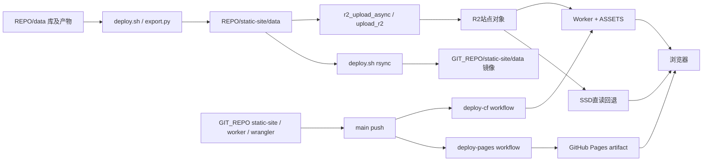

# 06 · 部署路径与面向用户的服务/界面（现状基线 v1）

基线 `d4238f5b24aa1aa5632dd5fed1098ce9fbdb3620`；盘点 2026-11-07（Asia/Shanghai，精确证据时间见inventory）。仅静态源码/配置盘点，**全部运行状态与业务健康 unknown**。代码存在不证明当前上线，exit0不证明数据正确。机器清单见 [surfaces.json](inventory/surfaces.json)。

既有 [站点部署](../../site-deployment.md)、[R2部署](../../r2-deployment.md)、[异步发布专题](../r2-publish-arch-industry-research-20261005.md) 继续作为专题权威，本页不替代操作规程。旧 [静态站说明](../../../static-site/DEPLOY.md) 的“无需Worker main”等表述与当前wrangler不同，现状配置以源码为准。

## 页面三站和数据三路径

| 页面域名 | 当前仓内配置/声明 | 证据与未知 |
| --- | --- | --- |
| ss.fx8.store | 主站识别；Workers Static Assets，Worker先行，ASSETS/R2/KV/D1 | wrangler.jsonc:11、worker/headers.js:319、app.js:33541、deploy-cf workflow；实际自定义域绑定、DNS、部署ref unknown |
| sss.sugas.site | GitHub Pages静态备站；main工作流发布static-site | deploy-pages workflow + site-deployment:600；实际域名关联/在线版本unknown；工作流不部署Worker，数据/认证仍可依赖主站 |
| s.sugas.site | 文档称MaoziYun静态镜像 | site-deployment:601/615、deploy.sh:1108同时出现手动/FTP和git自动拉取说法；实际机制、300MB限制是否仍生效unknown |

`ssd.fx8.store` 是common.js配置的R2备用直读域，不是独立数据生产系统。**页面三域名 ≠ R2审计的“三站”**：check_r2_consistency.py所谓三站是SSD桶直链、CF `/r2/`、MAIN `/data/`三条数据路径。两个静态备站可以共用主站/R2数据和认证，页面壳冗余不等于数据/认证独立容灾。

## 发布与镜像

实边表示源码调用/工作流/读取分支存在，不表示本轮已发生部署；未知MaoziYun链不画实边。

- `repo_paths.sh`解析REPO/GIT_REPO。双树角色为REPO（trade-data运行数据）与GIT_REPO（trade代码/发布）；本次文档worktree不是运行数据树。`upload_r2.py:73`读REPO/static-site，不能拿任意代码树镜像作最新源。
- `deploy.sh:393/708/723`导出后rsync静态产物，其他data同步排除DB、日志和部分告警状态；代码树data镜像不能替代运行库。staticdata是备份/变化历史角色，不是前端权威生产源，细节仍查R2专题及其它inventory。
- deploy先导出/完整性/版本门禁、min构建/rsync、触发R2，再串行git阶段。默认异步上传；Linux条件满足时systemd transient service，非systemd才nohup；同步回退开关存在但当前环境值未读。**push成功不证明异步R2完成**，页面壳与数据可处不同代。
- async有界锁、通道锁、进展/停滞/低速看门狗、收尾verify-r2与purge；并发跳过可请求一次额外数据阶段。verify-r2能补传、purge改缓存，均不是本轮可运行的只读探针。
- deploy-cf工作流按main指定路径变更部署Worker，deploy-pages按main推送发布static-site；前者注释提及CF Git integration兜底，控制面是否启用unknown。未读取Actions历史。

## 路由 → 模块 → 数据/endpoint → 发布/对账点

源码阅读app.js/lab.js/common.js，HTML实际加载对应min；非全业务子页穷举，定位锚点见inventory。

| 入口 | 模块 | 数据或endpoint | 对账点/发布 |
| --- | --- | --- | --- |
| `/#overview` | app/common | boot、overview、signals_today、intraday_snapshot、signal_stats、summary | 壳git，数据R2；boot聚合/独立文件代际、signals_today→overview回退 |
| `/#market/{a-stock,industry,hk,global}` | app | 各range、index/*-all、industry | 大range与小range目录不同，不可全部拼data前缀 |
| `/#sentiment/{market-temp,futures,national-team,public-fund}` | app | sentiment、futures、ETF/公募持仓 | 市场日历、源日期/T+1、采集完成时间分开 |
| `/#fund/{etf,offshore}` | app + fund handlers | 静态评分、`/api/fund_score`、`/api/fund_screener` | Worker+D1部分查询；R2新鲜不证明D1同步 |
| `/#lab`、`/#lab?sub=sigkelly`、`/#lab/<strategy>` | app懒加载lab、common | lab/*、signal_kelly_backtest/trades/parts/snapshots、loss_features、overfit_monitor | ND-open/SD-close产物不同；前端还重算筛选/仓位 |
| sigkelly内“实操步骤/全部计划” | lab `_at*` | nextday_plan、auto_trade_steps | 非独立执行页；data本地权威、static/R2为镜像；signal_date/buy_date/sell_date分开，显示filled不独立证明真实成交 |
| 通知按钮/设置弹窗 | app、SW | notifications.json、订阅API | 权限/偏好/去重影响可见性；浏览器事件≠运维投递台账/未恢复事故 |
| 采集健康点/数据更新规则弹窗 | app | overview.collect_health、intraday_snapshot、schedule_stats | 已有可复用时效与任务表；没有确认独立全局运维状态页 |
| 模拟弹窗、`/trade_sim.html`、`/r2/trade_sim/trade_sim_<id>.html` | app、生成HTML | trade_sim_indices、trade_sim_data、凯利交易数据 | HTML/JSON分通道；失败有旧HTML链接 |
| `/databrief.html` | 独立HTML/script | 数据/API说明 | 静态说明，非监控面板 |
| `/admin/feedback.html` | 内联script + auth handler | 相对`/api/feedback/admin` | 备站静态托管不自带Worker；不采集反馈正文或管理员凭证 |

盘中另有浏览器直连东财/腾讯等上游请求（app.js:13275/16387），带超时/熔断/备源，不是全部由Worker代理。服务端intraday_snapshot是另一条归档/回退证据。统一`/api/data/*`负责已有数据查询/鉴权/限流/计量，不等于实时行情生产。

## min、build、manifest、缓存、fallback

- index.html:333–342引用common/app min与lab/ECharts懒加载meta。build_min.py:42列八组源→min，优先git HEAD、允许workspace fallback；deploy.sh:695构建失败仅warn继续，min可能旧，不能仅核源码。
- bump_asset_version同步资源`?v=`、SW CACHE_VERSION、meta build-id、`__build.json`；inline-init检查build-id差异，仅在空闲/探活就绪后reload并防循环，读取失败不证明一致。PWA `manifest.json`是应用描述，不是发布完整性证据。
- Worker `/data`先R2，缺对象/异常回退ASSETS；`/r2`缺对象/异常为404/502。后者普通3600秒、nav桶no-store。`/data`overview/signals/关键凯利等0秒，boot/通知/任务统计等60秒，overfit主/ext600秒，其他默认3600秒。实际first-match优先，例如signal_stats命中0，不能只看后面的600列表。
- Worker cache key剥query，URL时间戳不保证绕edge；app历史结果默认5分钟缓存并有时效例外；SW overview为network-only，其它JSON有响应头新鲜度/网络失败缓存回退，离线数据不能当当前观测。
- common.js用显式目录白名单把本地路径映射真实R2 key；index/etf/lab/industry等不都在data下，trade_sim JSON别名为trade_sim_data。备站`./data`主动向主站改写，失败有SSD兜底；认证仍用主站API，数据回退成功不代表登录可用。
- 四种manifest分开：`__build.json`为前端构建标识；`manifest.json`为PWA描述；r2_export_proof的export manifest为产物归属/同轮证明；large-json backup manifest为私有备份索引。不能合成一个“版本号”。

## 已有监控生态与私有面板复用

| 现有源/界面 | 可复用字段 | 安全/语义边界 |
| --- | --- | --- |
| overview健康灯 | collect_health、collected_at、非ok项 | 最新run完成时间不等于各源最新/整体健康 |
| 数据更新规则弹窗 | overview/intraday各源时效 | T+1/日历/源日期与进程active分开 |
| schedule_stats任务表 | schedule、est、last_run、last_exit、R2 skip | last_run为最近开始；产物上传可能滞后；exit0非数据健康 |
| overfit_monitor主/ext | 首页/实验室模型监控 | 不是机器资源或整链可用性 |
| `GET /api/err/stats` | 现有错误统计API，未确认专属HTML看板 | POST是1%采样/每tab去重上限；统计缺失非0故障。GET源码接受共享管理头或getSessionUser结果，所见分支未查admin角色，不能凭注释当管理员专用；私有面板授权需另定 |
| feedback管理页 | 已有反馈运营界面 | 可能含用户内容，不读取实际内容，不复制管理密码 |
| notifications | 既有浏览器事件 | 与私有运维notify台账/去重状态/当前未恢复集不同 |

**待父任务设计，未实施：**私有运维面板优先复用以上产物/字段，分别保留repo声明、部署ref、runtime observed_at、数据日期。运行主机日志、告警台账、failed-unit等由其它inventory确认后再列可接入项；当前没有确认它们已有安全只读Web endpoint。不得暴露私有DB/备份桶、凭证、订阅导出/邮箱、委托编号、原始错误栈或任意文件读取。不新建业务API、任务、配置或权限。

## 待核实与验证边界

1. 三站部署ref、DNS/域绑定、MaoziYun发布机制、D1同步、当前健康全unknown，未外探。
2. 分别对齐REPO权威→R2→MAIN/CF/SSD，再看GIT镜像；一致性工具将local差异作为提示而非第四线上权威。
3. HTML/min/build-id/SW/发布ref与R2代际分别取证；push、上传和缓存失效是不同事件。
4. version consistency/progress、channel coverage、R2 consistency、platform-healthcheck只读源码，未执行。其部分wrapper含网络/通知，verify-r2还会补传。
5. 本轮无业务入口（含dry-run）、外部API/登录、构建/部署、大数据下载、配置/refs修改、commit/push或消息发送。主要入口与一跳依赖盘点，不宣称全调度/全前端/实时健康验收。
