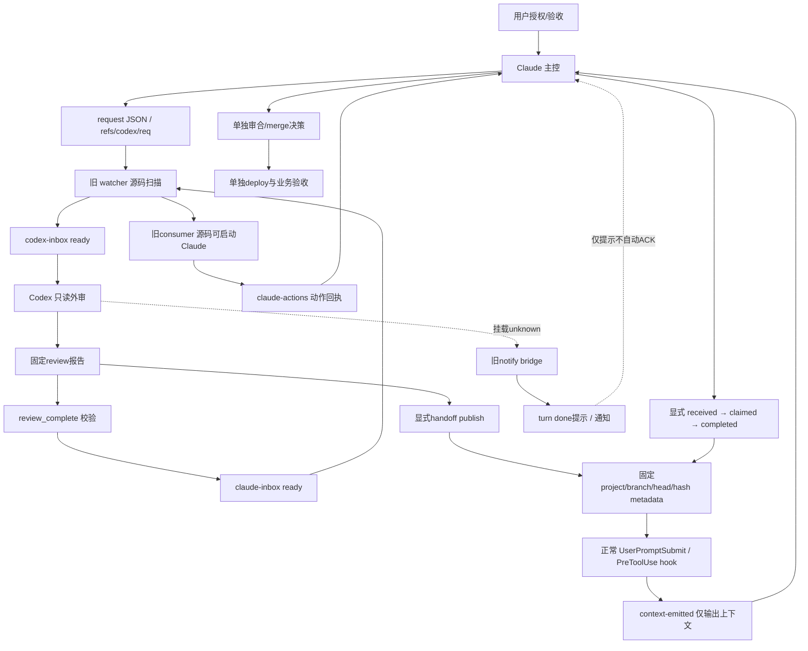

# 本机运行与人机协作现状基线（任务 F）

> 代码基线：`d4238f5b24aa1aa5632dd5fed1098ce9fbdb3620`。当前用户 launchd 观察时间（launchd 已废弃/历史存档，生产定时任务已迁云上 systemd timer，本机 mac 纯开发不跑生产定时任务，查 launchctl 是错的）：**2026-11-07T14:14:52.634032+08:00**（Asia/Shanghai）；磁盘 plist 解析时间见 JSON。本文只盘点，不调整角色、不启动任务、不替代既有运维权威文档。业务健康均为 `unknown`。
>
> ⚠️ 口径声明：本章盘点的是本机 launchd 历史存档/迁云残留（launchd 已废弃，生产定时任务已迁云上 systemd timer，现行清单见 `docs/deploy/systemd-units-20260912.md`）。下文出现的 launchd/launchctl/plist 字样均为历史陈述与迁云对账，不表示现行生产用 launchd。

机器清单：[runtime_local.json](inventory/runtime_local.json)，遵循 [inventory合同](_inventory-contract.md) 和 [schema](inventory/schema.json)。代码ref、磁盘声明、已加载label、业务健康是四个不同层次。

## 当前本机快照

| label | PID | last_exit | 本机文件声明 | 可确认与未知 |
|---|---:|---:|---|---|
| `com.trade.agent-inbox-watcher` | 3368 | 0 | RunAtLoad/KeepAlive；Python→`scripts/agent_inbox_watcher.py` | 当前域已加载且有PID；队列消费、心跳新鲜度、运行代码版本未知 |
| `com.trade.feishu-listener` | 10216 | 2 | RunAtLoad/KeepAlive；ThrottleInterval=10；Python→`scripts/feishu_ws_listener.py` | 当前有PID；last_exit=2仅历史进程状态线索，当前连接/收件/处理健康未知 |
| `com.trade.env` | — | 0 | RunAtLoad；入口`launchctl`（历史存档，查 launchctl 是错的，生产定时任务已迁云上 systemd timer），动作与参数不采集 | 已加载，无PID；不能据此认定环境已正确初始化，也不是常驻业务服务证明 |

当前用户域只有 **3 个**匹配label；其中2个有PID。`launchctl list`成功不代表全机所有域均已覆盖（launchd 已废弃/历史存档，生产定时任务已迁云上 systemd timer）。磁盘上的3份正式 plist（历史存档）也不证明当前进程按这些文件的最新字段启动。

本机另见 `com.trade.fetch-news.plist.json-bak-20260819`（历史存档，已迁云上 systemd timer）：只是相邻备份文件名，不是正式已挂载plist证据。允许字段解析失败，内容/标签/日历均 `unknown`，不向“损坏服务”升级。

## 仓内声明与迁云残留对账

仓内共11份匹配候选（含一份备份、一份`.disabled`目录声明）；与3份正式本机plist和1份相邻备份合并为 **13条调度/声明记录**。除watcher外，下表声明均未在本次当前用户label集合出现；**没有据此判定故障或迁云完成**。

| 源声明 | 安全入口 | 声明日历/状态 | 对账边界 |
|---|---|---|---|
| `launchd/com.trade.agent-inbox-watcher.plist` | `agent_inbox_watcher.py` | RunAtLoad/KeepAlive | 与本机label/磁盘入口同名；运行版本未知 |
| `scripts/com.trade.ab-direction-anchor.plist` | `run_ab_direction_anchor.sh` | 21:15 | 历史 plist，已迁云；possible→`trade-ab-direction-anchor`，交parent核云端 |
| `launchd/com.trade.check-data-gap.plist` | `check_data_gap_alerts.sh` | Weekday=1..5，22:35；ExitTimeOut=600 | 历史 plist，已迁云；possible→`trade-check-data-gap` |
| `launchd/com.trade.turnover-backfill.plist` | `turnover_backfill.sh` | Weekday=1..5，21:10；ExitTimeOut=300 | 历史 plist，已迁云；possible→`trade-turnover-backfill` |
| `launchd/com.trade.s06-snapshot.plist` | `s06_snapshot.sh` | Weekday=1..5，20:35；ExitTimeOut=600 | 历史 plist，已迁云；possible→`trade-s06-snapshot` |
| `docs/auto-trade/com.trade.nextday-plan.plist` | `nextday_plan.sh` | Weekday=1..5，22:30；ExitTimeOut=600 | 历史 plist，已迁云；possible→`trade-nextday-plan` |
| `launchd/com.trade.sentiment.plist` | module `app.scheduler` | 15:33 | 旧运维文档记旧scheduler遗留/不迁（历史存档，已迁云）；不是当前故障 |
| `scripts/com.trade.thinking-proxy.plist` | `sensenova-rotate-proxy.sh` | RunAtLoad/KeepAlive | 本机专属旧声明；功能/当前部署未知 |
| 同名`.plist.bak-*` | `thinking_proxy.py` | 备份声明 | 不作为第二个当前任务计数 |
| `scripts/.disabled/com.trade.thinking-proxy-kimi.plist` | `sensenova-rotate-proxy-kimi.sh` | 存储在disabled目录 | 目录标记不等于launchd Disabled覆盖值；实际覆盖unknown |
| `scripts/com.trade.sensenova-healthcheck.plist` | unknown | 白名单解析失败 | 仅文件声明；旧文档“不迁”，不能认定当前健康检查运行 |

日历按宿主机本地时间解释；本次观察时间偏移+08:00，OS时区标识未查询。脚本内部交易日门控、输入产物、业务超时/锁/恢复标准未逐个执行验证，逐字段保留unknown。`ExitTimeOut`只作为plist字段，不冒充完整业务deadline。

5条possible云映射依据旧 [systemd快照](../../deploy/systemd-units-cloud-snapshot.txt) 的源label描述；不是当前云端实测边。历史 [迁移盘点](../../deploy/migration-inventory-20260912.md) 曾记录40个`com.trade.*`，属于旧时点，不沿用其数量。迁移与本机专属权威说明保留于 [systemd运维说明](../../deploy/systemd-units-20260912.md) §5/§6。

## 三条协作通道与角色

角色权威：[Codex reviewer规范](../../../.agents/codex-reviewer/SKILL.md)。Claude是主控，负责复核、修复、merge/deploy决策；Codex是只读外审，本轮仅有指定架构文档产出授权；用户提供授权与验收。自动化图不扩张当前权限。

实线表示固定base源码/协议的功能连接，**不是本机正在执行或已完整送达的证明**。虚线为未核实挂载/提示作用。图中旧watcher与consumer的实际部署版本、是否正在处理请求未验证；本轮没有启动consumer或发送任何信号。

1. **旧ref/ready通道**：[协议](../../codex-collab-protocol.md)定义request范围、报告与ready。源码watcher轮询 **5秒**，每kind最多一个worker，失败退避60秒、最多10次，worker硬超时3600秒；PID锁与heartbeat仅在源码确认，未读取真实队列/日志/心跳。它能启动Codex worker及`claude-inbox-consumer.sh`，后者源码会在隔离worktree启动Claude，复核/处置并写动作回执，禁止其commit/push。这里的`done`/consumer exit0不等于修复已被主控接受。
2. **新metadata/ACK通道**：[handoff权威说明](../codex-handoff-inbox.md)。`publish`固定完整本地commit与报告SHA，不证明push、merge或上线。正常hook按project读取metadata，仓内settings声明两个事件、timeout5秒；本机Claude是否实际加载unknown。`queued`只表示已入队；`context-emitted`只表示输出过上下文；`received/claimed/completed`必须操作者逐步显式ACK并重新验证head/hash。`completed`仍不等同merge/deploy。报告变更或不可读可使身份失效，历史回执不保证当前有效。hook不自动ACK，不运行报告任务，不读取transcript；目录0700、packet0600、稳定flock、唯一临时文件原子替换。hook内部4秒、锁等待0.5秒、单事件扫描32packet/至多4次报告hash；CLI锁等待3秒，Git查询timeout1秒均是源码合同，非本轮实测延迟。
3. **旧turn提示/消息通道**：`codex_notify_bridge.py`源码可写`.done`并发通知，不调用LLM；本机Codex实际挂载未知，因为按授权未读取用户Codex配置。`.done`、最后一条回复、群消息不自动转换为handoff发布或显式ACK。listener的源码还含需求落盘、TASKS待办追加和消息回执逻辑；本轮不读取任何私人聊天/实际收件内容，不将有PID当成已成功接单。

### 需要parent核对的协议—源码差异

| 主题 | 固定base的源码 | 旧协议陈述 | 本轮处理 |
|---|---|---|---|
| watcher是否后台调用Claude | `build_claude_command`→consumer；consumer `exec Claude` | 协议称watcher只机检/提醒、不后台调用Claude | 保留两方证据；运行进程版本/批准边界unknown，交主控核对；不静默改变角色权限 |
| watcher轮询频次 | `POLL_SECONDS=5` | 协议描述2秒 | 当前源码记录5秒；运行值unknown |
| ref生命周期 | watcher源码有`cleanup_ref`删除request ref | 协议要求reviewer不写.git/refs | 区分脚本能力与当前会话授权；本轮不查询request正文、不改refs |

上述是现状对账项，不是本轮修复或启动授权。merge入口仍是主控的`main-merge.sh`，发布/上线另行验收；本轮包括dry-run在内均未运行任何业务入口。

## 失败、未知与保护边界覆盖

| 面 | 已覆盖证据 | 保留的失败/未知 | 保护措施 |
|---|---|---|---|
| 调度注册 | 当前用户3个label、PID/last_exit | 其它用户/system域未知；无label不判故障 | 仅list，不load/unload/kickstart |
| 本机声明 | 3正式plist+1备份，允许字段提取 | 备份与1仓内模板解析unknown；没有读取disabled覆盖 | 不改plist，不输出环境字典/完整参数 |
| watcher | 注册PID、磁盘入口、源码锁/轮询/重试 | 心跳/队列/运行版本/消费成果unknown；协议差异待对账 | 不启动worker、consumer、不执行入口，不读报告正文 |
| listener | 注册PID、last_exit2、磁盘入口、源码接收边界 | WebSocket连接/消息落盘/处理健康unknown | 不读配置/凭据/聊天，不发送消息 |
| metadata/ACK | repo源码、协议与settings事件声明 | live加载、真实发布/ACK/理解均unknown | 不运行hook/publish/ack/status，不读transcript/真实packet |
| merge/deploy | 角色规范和主控脚本声明 | 当前审合/部署/线上健康不在本任务验证范围 | 不commit/push/部署/业务dry-run |
| cloud映射 | 5条旧快照源label的possible映射 | 当前云上是否同任务、已迁或重复挂载unknown | 交parent对账；不SSH、不访问云或启动消费者 |

## 范围与维护

证据层级：`runtime_observed`只覆盖本机注册快照；`code_confirmed`覆盖固定base/磁盘声明；旧迁移信息仅`documented_only`；云映射是possible，不进入已确认`depends_on`。无新拟运行任务，不将计划项计入在线清单。数据目录、账号、连接参数已省略或脱敏；原始完整参数、环境字典、密钥、邮件账号、通知地址不进入仓内文档。

仅更新本页与`inventory/runtime_local.json`。私有脱敏证据为`/tmp/codex-reports/ops-architecture-baseline-20261107/local-runtime-*`，0600原子写入。后续变更应分别更新代码ref、部署ref、观察时间，并继续引用既有专题权威文档，不用本基线覆盖旧操作规范。
