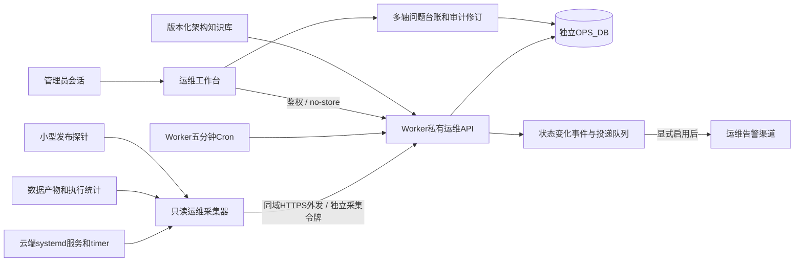

# 在线运维工作台与持续采集

本篇在2026-11-07盘点基线上补充可运行实现。用户本次授权Codex在独立分支实现，Claude审核、合并和部署；原有外审职责不作永久变更。01—11专题与inventory保留各自取证时间；本篇新增能力上线前，不能把旧观察改写成实时状态。

## 实际组成

入口为主站同源`/admin/ops.html`。空页面可以公开访问，运行快照、基线、历史与问题明细必须经过`/api/ops/*`管理员认证。已有登录用户只有命中管理员allowlist才可访问；独立采集令牌只能上传。没有OPS_DB、没有有效数据或采集已失联时显示未配置、未知或过期，不能默认绿灯。

私有状态进入新建OPS_DB，不进入公开R2、静态data目录、订阅KV或基金评分D1。采集器主动HTTPS外发，不新增云服务器入站端口。Web管理代码与私有API绕过Service Worker离线缓存；接口返回no-store。

## 六个工作视图

| 视图 | 能做什么 | 判定边界 |
| --- | --- | --- |
| 概览 | 采集新鲜度、检查状态分布、当前异常及入口 | 当前检查成功不等于业务全链路通过 |
| 服务与定时器 | 对照实际服务、同名timer与版本声明，查看证据 | oneshot处于inactive不能单独判故障；timer成功不能代替service退出码 |
| 数据与发布 | 区分数据文件、发布链路、备份和资源观察 | 存在、mtime、HTTP200不能代替内容正确或完成恢复演练 |
| 架构与知识库 | 搜索目录、点选关系和对象、追溯上下游及依据 | 文档/推断/计划保持原标记与原取证时间 |
| 问题与跟进 | 18条近期基线及修复、根因、部署、复验、观察状态，追加人工修订 | 当前指标恢复不能自动根治结案；历史不可回放不等于已补回 |
| 采集与事件 | 运行历史、状态变化、恢复、告警投递结果 | 重复采样不重复生成相同故障；网络不确定时仍可能重复投递 |

提供搜索、筛选、详情、轮询暂停、手动刷新、私有导出。移动端使用独立紧凑样式，不修改市场全景、信号凯利等业务页面的布局或按钮。

## 问题台账更新规则

版本基线永不被采集器或人工整文件覆盖。人工更新使用预期revision比较并追加审计记录；发生并发冲突返回409，必须重新核对最新状态。修复状态、根因状态、部署状态、验证状态和观察窗口分别记录。关闭需要明确的证据与验证/观察，不会把ACK、CI通过、退出码0或本次无告警转换为“全部根治”。

## 自监控与数据保留

云端采集和Worker失联探测分别由独立调度器触发。首次尚未成功上报有15分钟初始化宽限，超过宽限仍无第一份快照也会形成失联事件，避免监控从未建立却一直静默。采集链停掉后，Worker仍可根据最后一次证据的时间发出失联事件。Worker/Cloudflare整体不可用则需现有站点外部探测兜底；同一平台上的Cron不是独立灾备，面板失效不意味着没有故障。

D1持久保存采集记录、状态变化、告警待投递队列、人工修订。保留最后一份完整快照，其余全量近快照24小时、摘要历史30天，事件和历史修订90天清理；当前问题覆盖状态继续保存。详情以[协议](../../../ops/monitoring/contract.md)和实际SQL为准。数据库导出需要管理员权限，导出文件应作为私有备份保管；不写入公开静态站点。

## 本地验收和上线边界

实现、迁移、本地独立绑定、只读采集配置、安装包、部署核对工具均在[ops/monitoring](../../../ops/monitoring/)；生产步骤见[DEPLOY.md](../../../ops/monitoring/DEPLOY.md)。本地必须使用专用`wrangler.local.jsonc`，禁止直接用原根配置启动dev：原SUBSCRIBE_KV明确`remote:true`。

生产配置必须长期归并到根`wrangler.jsonc`：专用OPS_DB的真实UUID、仓库相对迁移路径、独立Cron及通知开关都需随部署整合提交；秘密仍只进Cloudflare secrets。`/tmp`候选用于路径预检和部署，不替代仓库事实源，也不能含本机绝对路径整文件覆盖根配置。只改控制台或仅部署一次候选，下次自动发布会恢复旧绑定/开关，不能据此结案。

生产需Claude完成：复核固定提交、新建专用D1并迁移、合入真实binding与Cron、保密设置密钥、部署Worker、安装采集service/timer、执行只读上线核对，再记录自然周期证据。告警发送需要显式启用，默认只投递采集器失联及恢复；业务故障仍由原有告警链负责，面板记录事件并标明投递抑制原因，防止同一任务被多套系统重复直发。扩展投递范围须先审核归属与去重，不能靠本地假消息证明生产通道已通。代码完成、本地验收通过、已推送、已上线和自然周期通过必须逐项分开回执。

知识库维护使用原构建/校验工具；服务器内嵌基线另用build_baseline.py生成并检查，防止页面上线后知识库仍停在旧清单。新控制面任务纳入现有UNIT_REGISTRY与canonical systemd文档，原44项运行取证保留为历史观察；新任务未安装前不能声称云端已观察到45项。

## 本次已完成的限定验证

真实本地Worker/D1完成鉴权、幂等、乱序、过大输入、历史、问题修订、调度和导出；实际collector CLI向本地API提交成功。桌面1440与手机390宽度完成服务证据下钻、架构导航、搜索空态、人工修订、认证失效清私有内容，无JS异常或整页横溢。

最终采集器源码还在云端以内存方式只读试采：44个service、44个timer、85条OnCalendar、34资产组，共175项，约0.30秒、75KB；未写云端文件、安装任务、上传生产监控状态或发通知。观察结果133项运行层OK、1项service critical、1项派生执行warning、40项unknown，不是全站业务通过率；两条异常对应同一换手率任务，业务影响和根因仍待原问题链复核。新增45号监控任务尚未生产安装，不能将云端44误报成已观察到45。

知识库API消除重复观测全文后，服务端基线约859KB（保留368实体/371条完整可重建观察）；整个Worker预构建约120KiB gzip。本机启动采样活跃CPU约27毫秒，不能作为Cloudflare线上延时承诺。最后固定提交的验证与哈希以私有交接报告为准。
